# Proyecto 02 - Landing Page: Juegos de Antes y de Ahora ("Un choque generacional en Guayaquil")

## Fase 3: Desarrollo (Sprint 1) - Organización del contenido y selección de la plantilla

**Materia:** Desarrollo de Aplicaciones Web y Móviles (SOFG1006)  
**Institución:** Escuela Superior Politécnica del Litoral (ESPOL)  
**Integrantes:**
* María Belén Alay Méndez
* Abraham Smith Romero Rondón

### Contexto de la página:
Sitio web que analiza la evolución de los juegos de las generaciones pasadas vs las actuales en Guayaquil. Proyecto académico para la materia Desarrollo de Aplicaciones Web y Móviles.

### 1. Organización del Contenido
| Nombre de la Sección | Propósito | Datos que se presentan |
| :--- | :--- | :--- |
| **Hero / Inicio** | Captar el interés y presentar la temática. | Título principal, problemática de la infancia en Guayaquil e imagen destacada. |
| **Contexto y Ubicación (¿De dónde somos?)** | Presentar el área geográfica del estudio. | Descripción del sector Málaga 2 (Guayaquil) y mapa interactivo embebido. |
| **Hallazgos de las Entrevistas** | Mostrar conclusiones cuantitativas de las encuestas. | Datos sobre el 100% de impacto en inseguridad, brecha tecnológica y desuso de juegos tradicionales. |
| **Referencia Multimedia** | Mostrar contenido audiovisual para conocer más del tema tratado (juegos tradicionales y actuales). | Videos o documentales relacionados a los juegos tradicionales como a los actuales. |
| **Testimonios y Experiencias** | Exponer las vivencias de distintas generaciones. | Tarjetas con imágenes anonimizadas, rango de edad, cita textual y juego favorito de 11 entrevistados. |
| **Footer / Formulario (¡Escríbenos tu experiencia!)** | Que el visitante participe en la investigación mediante el relato de su experiencia. | Formulario compuesto por el nombre, rango de edad, correo y el mensaje a escribir. |

### 2. Análisis Comparativo de Plantillas (HTML5 UP)
#### Plantillas Identificadas
##### Zerofour
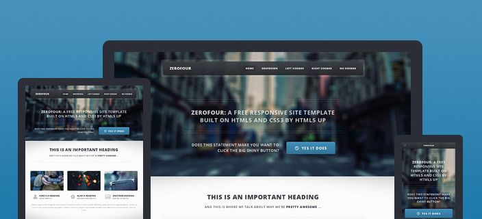

##### Massively
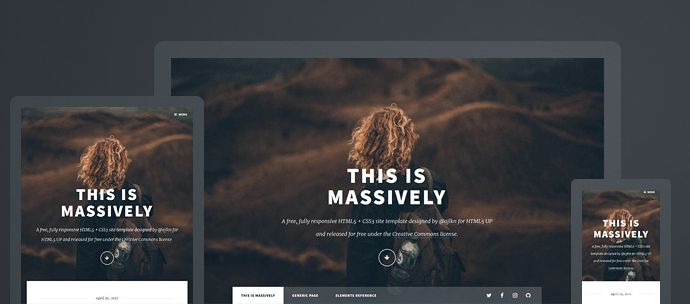

##### Solid State
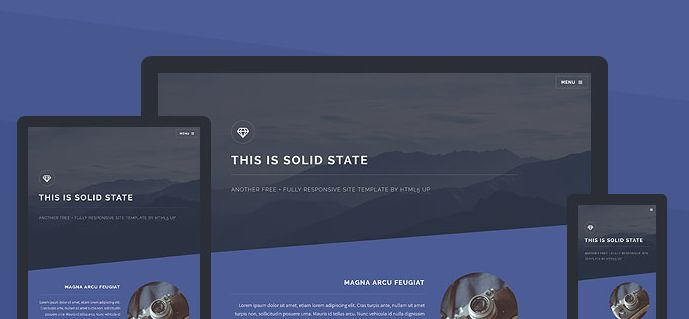

#### Tabla Comparativa
| Criterio | Plantilla 1: Zerofour | Plantilla 2: Massively | Plantilla 3: Solid State (Elegida) |
| :--- | :--- | :--- | :--- |
| **Estructura** | Menú arriba tradicional con banners de información. | Portada gigante pensada para artículos largos o blogs. | Secciones en bloques inclinados con tarjetas modulares. |
| **Navegación** | Barra de navegación horizontal clásica. | Scroll largo continuo. | Menú lateral desplegable muy limpio. |
| **Diseño** | Estilo un poco corporativo y más formal. | Enfocado en fotos grandes de alta calidad. | Oscuro, moderno y con bloques de buen impacto visual. |
| **Adaptabilidad** | Funciona bien en PC, pero algo pesada en celulares. | Adaptable, pero requiere fotos muy grandes para no distorsionarse. | Se adapta excelente a pantallas de celulares y laptops. |
| **Personalización** | Intermedia. | Un poco complicada para organizar tablas y testimonios. | Muy fácil de modificar para nuestras tarjetas de entrevistas y el formulario. |

### 3. Selección y Justificación de la Plantilla
Elegimos la plantilla **Solid State** porque nos pareció la más dinámica para presentar nuestra investigación ya que nos gusta la idea de presentar la información y frases relevantes de manera visual como tarjetas. Por lo tanto, su diseño en bloques y tarjetas nos permite organizar de forma clara las frases de los entrevistados con sus fotos, mostrar el mapa de Guayaquil y agregar el formulario de participación sin que la página se vea cargada y afecte la experiencia del usuario. Además, al probarla vimos que se adapta muy bien en teléfonos móviles lo cual es un dato importante también.
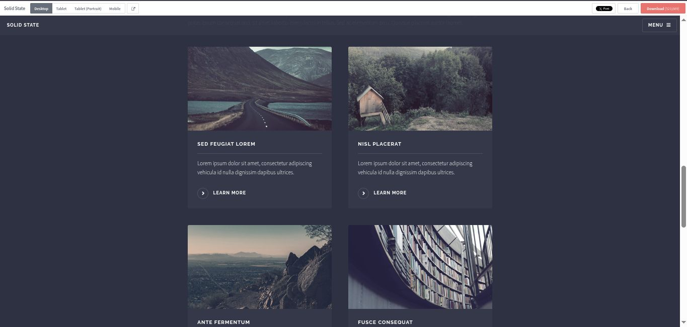

## Fase 3: Desarrollo (Sprint 2) - Implementación, personalización y despliegue de la landing page
Modificamos la estructura y el contenido HTML de la plantilla para incorporar las secciones de la investigación y ajustar la navegación entre ellas. También se añadieron gráficos y estadísticas con la biblioteca Chart.js para presentar visualmente algunos de los resultados obtenidos.
En cuanto al CSS, personalizamos los estilos, ajustando los fondos, los colores y otros elementos decorativos para dar identidad visual a la página. Para algunos de estos cambios, tomamos como referencia páginas de recursos web, mencionadas en la sección correspondiente, con el propósito de hacer más llamativa la presentación de la investigación.
### Vista de la página
#### Banner
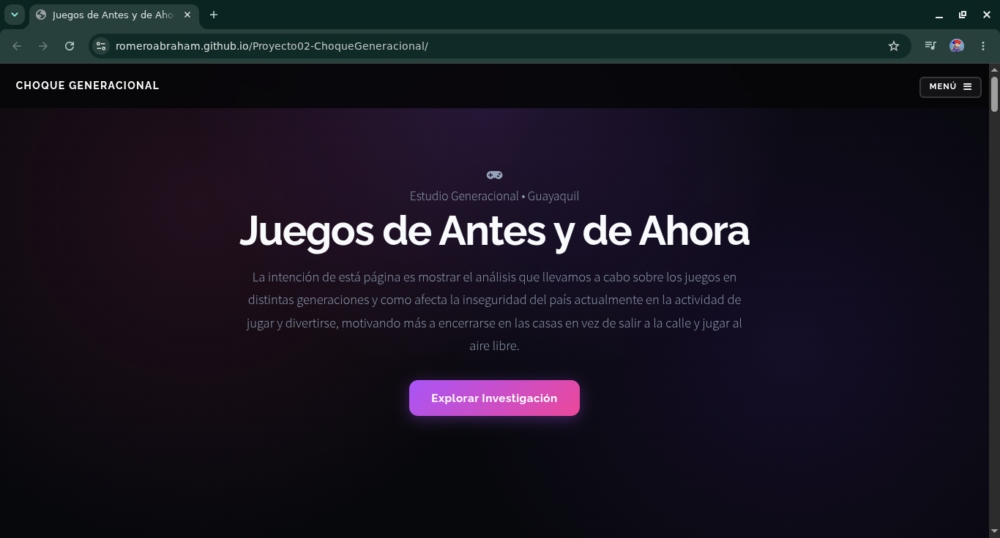

#### Menú
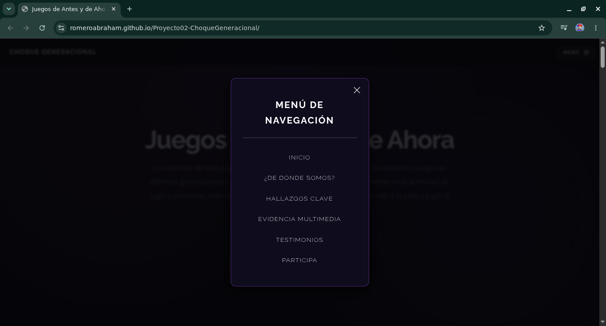

#### Wrapper
##### ¿De dónde somos?
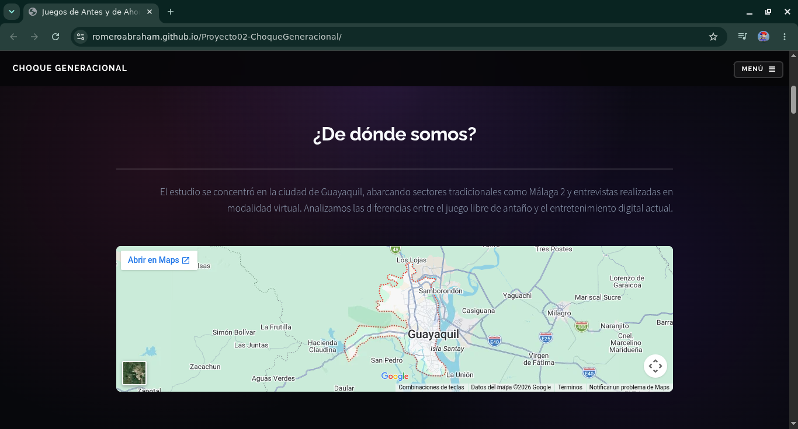
##### Hallazgos de las Entrevistas
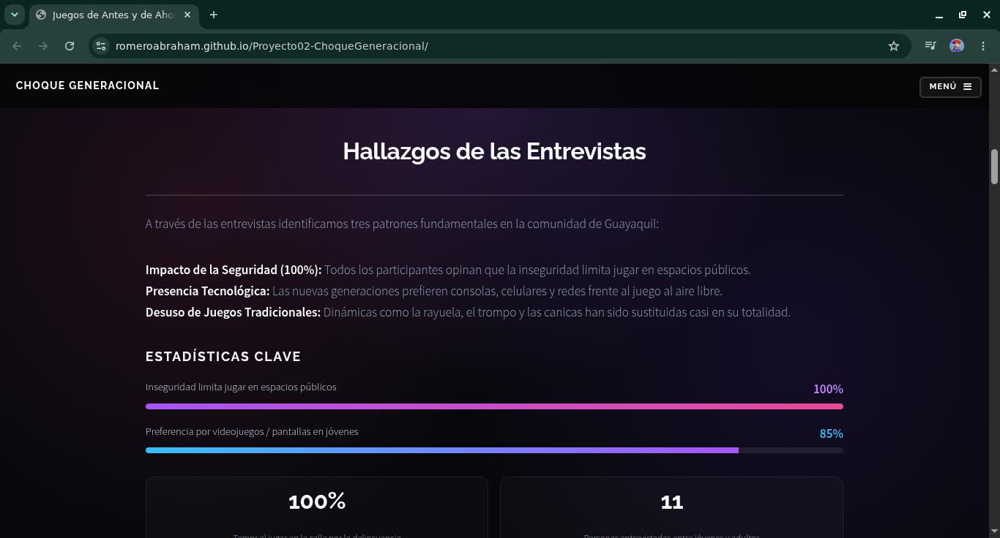
##### Referencia Multimedia
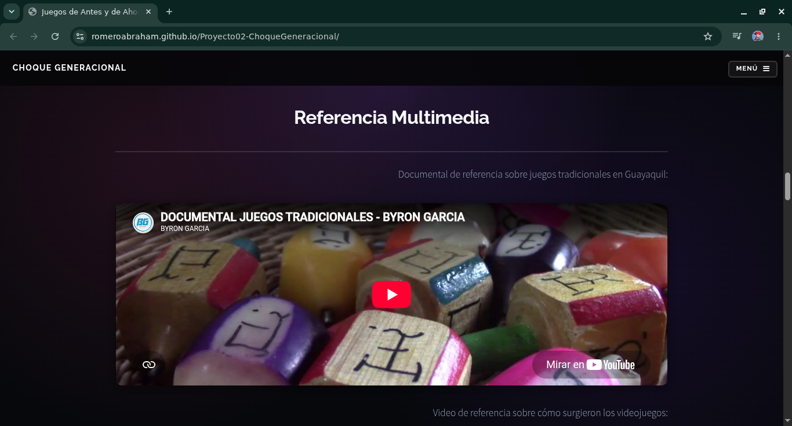
##### Testimonios y Experiencias de la Comunidad
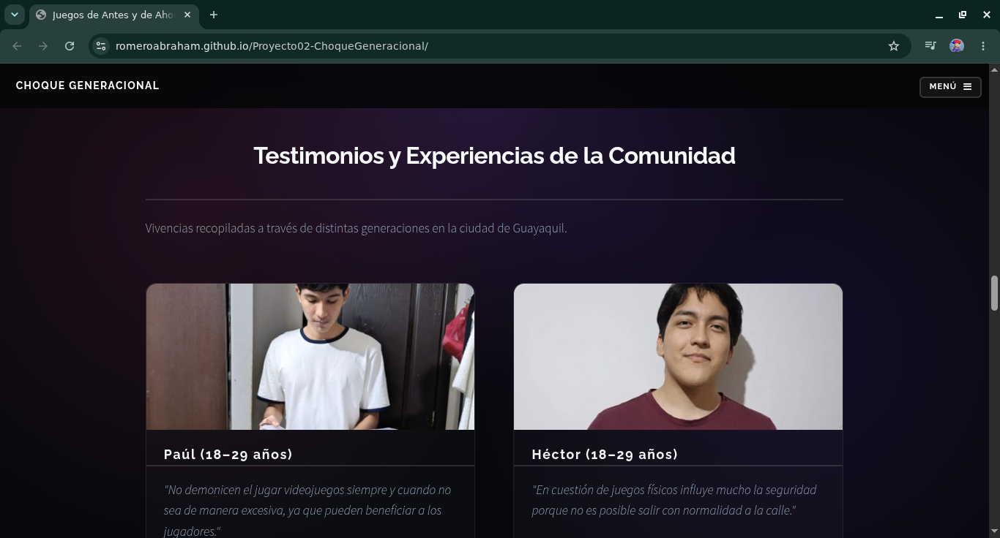

#### Footer
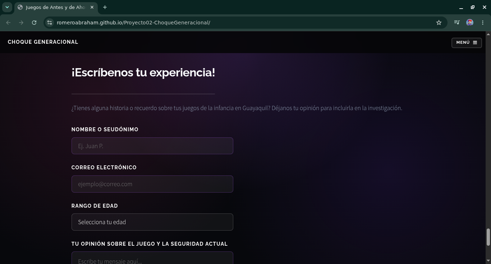

### Despliegue
La landing page se publicó mediante GitHub Pages para que el sitio pudiera consultarse desde
una URL pública. Se verificó su visualización y el funcionamiento de sus principales elementos,
incluyendo el contenido, las imágenes, los enlaces y los estilos.

**Landing page publicada:** https://romeroabraham.github.io/Proyecto02-ChoqueGeneracional/

### Documentación Completa
El informe completo con el análisis de encuestas, planificación, diseño de la entrevista y bibliografía se encuentra en la carpeta `/docs` de este repositorio.

## Referencias
Byron Garcia. (s. f.). *Documental juegos tradicionales* [Video]. YouTube. https://youtu.be/CFEgiAC1kYo

Capture. (s. f.). *Capture*. https://captureapp.xyz/

Dark Mode Design. (s. f.). *Dark Mode Design*. https://www.darkmodedesign.com/

dhero.studio. (s. f.). *dhero.studio*. https://dhero.studio/

HTML5 UP. (s. f.). *HTML5 UP*. https://html5up.net/

HTML5 UP. (s. f.). *Solid State*. https://html5up.net/solid-state

React Bits. (s. f.). *Fold Text*. https://reactbits.dev/text-animations/fold-text

React Bits. (s. f.). *Tech Text*. https://reactbits.dev/text-animations/tech-text

*¿Cómo surgieron los videojuegos? 12 datos curiosos* [Video]. (s. f.). YouTube. https://youtu.be/sEQON0sVBrk